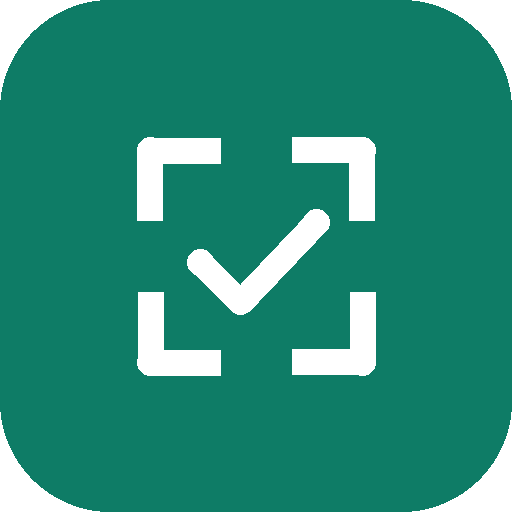

# Smart Attendance (Attendance Machine)

**किसी भी Android फ़ोन या टैबलेट को फेस-रिकग्निशन अटेंडेंस मशीन बनाइए, जो सीधे DA Workforce से जुड़ी है।**
Turn any Android phone or tablet into a face-recognition attendance machine connected to DA Workforce.

- डाउनलोड / Download: **[SmartAttendance-1.0.8.apk](https://github.com/datplindia/datpl-software/raw/main/attendance-machine/SmartAttendance-1.0.8.apk)** (Android 8+, ~80 MB)
- मशीन जोड़ने का कोड / pairing code: **DA Workforce → Settings → Attendance → Add machine**
- आज की अटेंडेंस / today's attendance: **DA Workforce → Dashboard → "Attendance today"**

## सुविधाएँ / Features

- **चेहरे से अटेंडेंस**, फ़ोन पर ही (ऑफ़लाइन AI): स्क्रीन पर दिखे सब लोग एक साथ, कहीं भी
- **पहली बार दिखे = IN, आख़िरी बार दिखे = OUT**; दिन भर बार-बार दिखने पर कोई नया पंच नहीं
- **रिसेप्शन मोड**: दिन भर चुप; सिर्फ़ चेक-इन और चेक-आउट पर "ting" और बड़ा ✓। ग्राहकों के चेहरों पर कोई बॉक्स नहीं; कोई न दिखे तो स्क्रीन धीमी
- **RFID / NFC कार्ड** (फ़ोन का NFC या USB 13.56 MHz रीडर) और **PIN**; कर्मचारी-स्तर पर FACE+CARD जैसे दो-तरीके
- **DA Workforce में अपने-आप**: attendance_events + attendance_days, लंच कटौती (डिफ़ॉल्ट 1 घंटा), ओवरटाइम Pending में (Payroll में Approve करने पर सैलरी में)
- **इंटरनेट न हो तब भी** अटेंडेंस; नेट आते ही सिंक
- **किओस्क मोड**: मशीन पर सिर्फ़ यही ऐप; फ़ोन की ग़लत घड़ी का अपने-आप सुधार
- सिर्फ़ इंग्लिश UI

## सेटअप 5 कदम / Setup in 5 steps

1. APK फ़ोन/टैबलेट में डालें → install (Unknown apps को Allow) → कैमरा अनुमति दें।
2. DA Workforce → **Settings → Attendance → Add machine** → 6 अंकों का कोड (30 मिनट वैध)।
3. ऐप में कोड डालें → **Pair** → 6 अंकों का **एडमिन PIN** बनाएँ।
4. एडमिन (कंपनी का नाम लंबा दबाएँ) → **Employees** → नाम → **Face → Enrol** (5 फ़ोटो अपने-आप)। चाहें तो **Card** और **PIN** भी।
5. मशीन को आँख की ऊँचाई (150–160 cm) पर लगाएँ, चेहरे पर सामने से रोशनी हो। Samsung पर **Settings → Battery → Battery protection → Maximum (80%)**।

नया वर्ज़न पुराने के ऊपर ही install करें (uninstall नहीं), ताकि पेयरिंग और डेटा बना रहे।
Install new versions over the old one (do not uninstall) to keep pairing and data.

## हार्डवेयर / Hardware (लगभग ₹13,000–20,000)

8–10" Android टैबलेट (या NFC वाला फ़ोन) · 13.56 MHz USB HID कार्ड रीडर (अगर NFC नहीं) · PD पास-थ्रू USB-C हब · 20–25 W चार्जर · LED पट्टी · acrylic/ACP केस (कैमरा-छेद 12–15 mm, "TAP CARD" ज़ोन, हवा के छेद, ताला)।

## वर्ज़न / Versions

| वर्ज़न | मुख्य बदलाव |
|---|---|
| 1.0.8 | एक व्यक्ति = एक नाम (सख़्त मिलान); रिसेप्शन मोड: ting + बड़ा ✓ सिर्फ़ IN/OUT पर, बाकी चुप; स्क्रीन धीमी |
| 1.0.6 | पहली बार दिखे = IN, आख़िरी बार दिखे = OUT |
| 1.0.5 | स्क्रीन पर एक साथ कई लोगों की अटेंडेंस |
| 1.0.3 | पूरा ऐप इंग्लिश में |

[`version.json`](version.json) में ताज़ा वर्ज़न, डाउनलोड लिंक और SHA-256 है।

## कैसे बना है / How it is built

| हिस्सा | कहाँ |
|---|---|
| Android ऐप (Kotlin, Jetpack Compose, CameraX, ML Kit, TFLite MobileFaceNet, Room) | सोर्स कोड प्राइवेट रिपॉज़िटरी `datplindia/da-workforce`, ब्रांच `attendance-machine` |
| सर्वर | Supabase प्रोजेक्ट `da-workforce`: टेबल `bio_*`, Edge Function `bio-device`, RPC `bio_create_device` / `bio_repair_device` |
| Workforce से जोड़ | ट्रिगर `bio_bridge_punch` → `attendance_events`; `bio_recompute_attendance_day` → `attendance_days` + `overtime_entries` |

चेहरे की फ़ोटो नहीं, सिर्फ़ गणितीय वेक्टर (embedding) सर्वर पर रहता है। कर्मचारियों से लिखित सहमति लें (DPDP Act 2023)।
Only a numeric face vector (no photo) is stored. Take written consent from staff (DPDP Act 2023).
