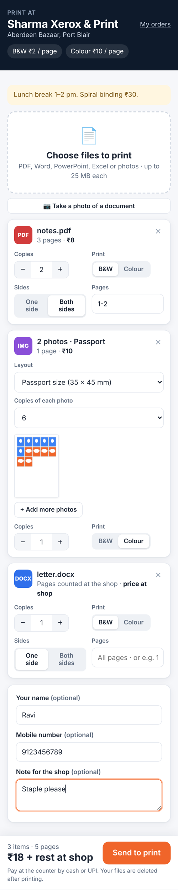
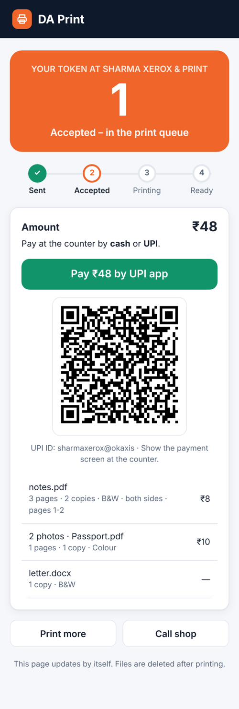
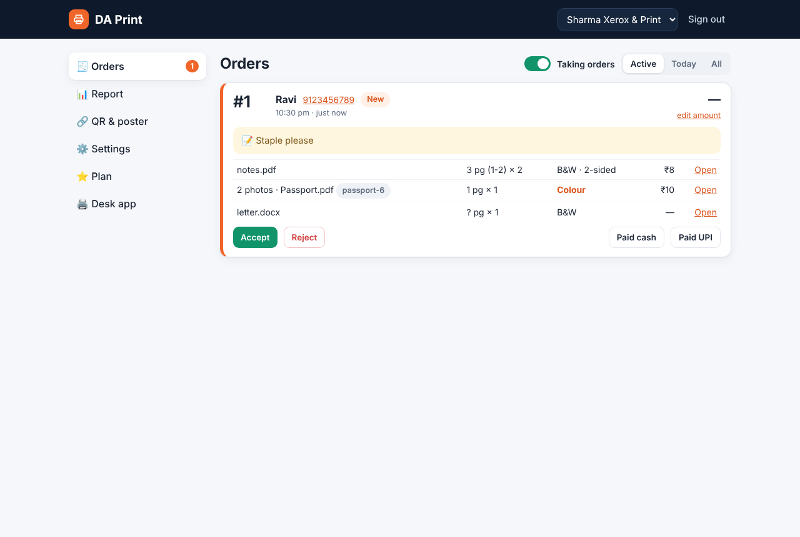
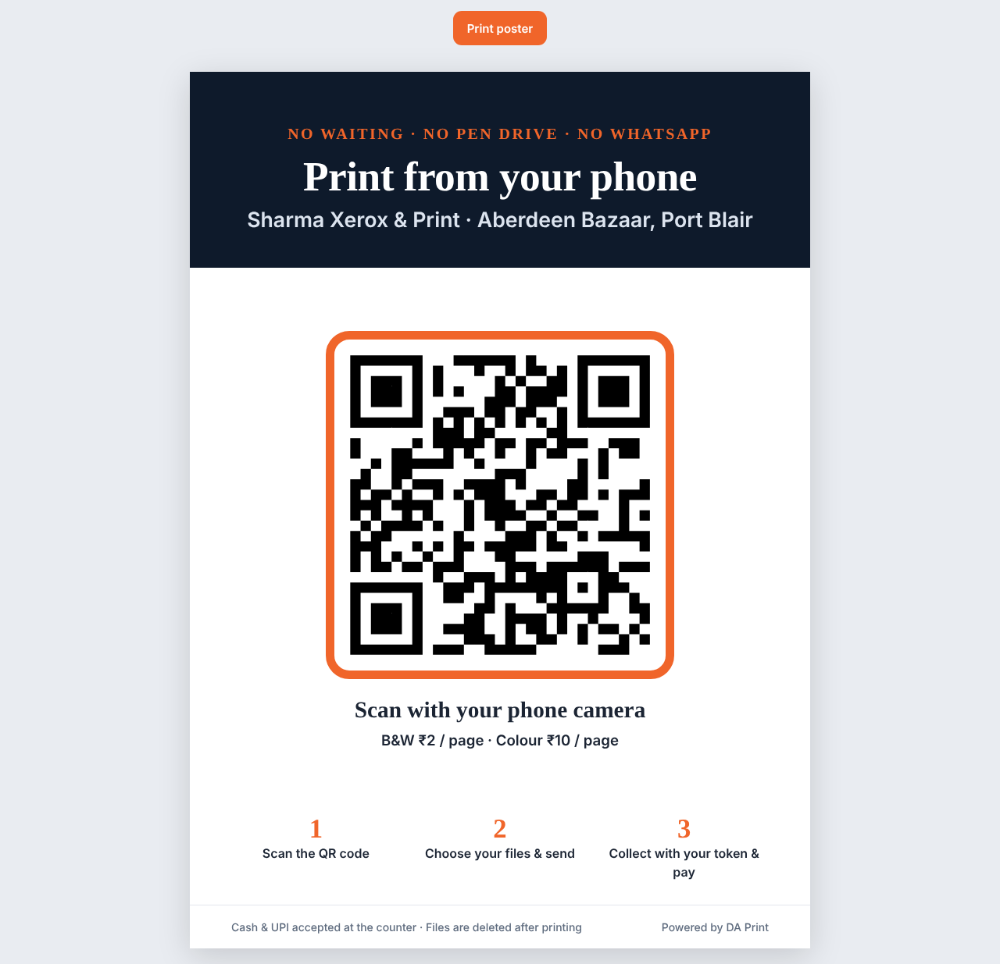

# DA Print

प्रिंट की दुकानों के लिए सेल्फ-सर्विस प्रिंटिंग। ग्राहक काउंटर पर लगा QR स्कैन करता है, फ़ोन से फ़ाइल भेजता है और टोकन नंबर पाता है। दुकानदार Accept दबाता है और **DA Print Desk** (Windows ऐप) अपने आप प्रिंट कर देता है: B&W ऑर्डर B&W प्रिंटर पर, कलर ऑर्डर कलर प्रिंटर पर। पेमेंट काउंटर पर कैश या UPI से।

Self-service printing for print shops. Customers scan the counter QR code, send files from the phone and get a token. The shop presses Accept and **DA Print Desk** (Windows) prints by itself. Payment at the counter by cash or UPI.

- वेबसाइट / Website: **https://print.datpl.com** (दुकान का अकाउंट: print.datpl.com/dashboard)
- लाइसेंस / Licence: हर दुकान का प्लान DA Workforce → Software licences → **DA Print** में। 15 दिन फ्री ट्रायल।

## डाउनलोड / Download: DA Print Desk

**[DAPrintDesk-1.6.7.zip](https://github.com/datplindia/datpl-software/raw/main/da-print/DAPrintDesk-1.6.7.zip)**: Windows 10 / 11, लगभग 8 MB, इंस्टॉल की ज़रूरत नहीं।

1. ज़िप खोलें। पूरा फ़ोल्डर साथ रखें (`DAPrintDesk.exe` के साथ `x64` और `x86` फ़ोल्डर)।
2. `DAPrintDesk.exe` चलाएँ। Windows "Windows protected your PC" दिखाए तो **More info › Run anyway** दबाएँ।
3. print.datpl.com वाले ईमेल और पासवर्ड से साइन इन करें।
4. B&W प्रिंटर और कलर प्रिंटर चुनें, फिर **Test print** दबाएँ।
   एक ही प्रिंटर है? उसे B&W प्रिंटर में चुनें, बाकी खाली छोड़ें। **More printers…** में फ़ोटो पेपर वाले टाइप पर "Ask first" टिक करें।

Word, Excel और PowerPoint फ़ाइलें कंप्यूटर में लगे Microsoft Office (या मुफ़्त LibreOffice) से PDF बनती हैं।
Unzip, run `DAPrintDesk.exe`, sign in with the print.datpl.com account, choose the printers and press Test print.
ज़िप इसी फ़ोल्डर में है / The ZIP is in this folder: [DAPrintDesk-1.6.7.zip](DAPrintDesk-1.6.7.zip)

## PDF

- [DA-Print-Features.pdf](docs/DA-Print-Features.pdf): सारे फ़ीचर / all features
- [DA-Print-Installation-Guide.pdf](docs/DA-Print-Installation-Guide.pdf): दुकान बनाना + DA Print Desk इंस्टॉल करना / setup guide

## क्या-क्या है / Features

- ग्राहक के लिए कोई ऐप या लॉगिन नहीं: फ़ोन के ब्राउज़र में खुलता है
- PDF, Word, Excel, PowerPoint और फ़ोटो; कॉपी, B&W / कलर, दोनों तरफ़, पेज रेंज
- फ़ोटो लेआउट: 1/2/4 प्रति पेज, पासपोर्ट साइज़ (35×45 mm), आधार / ID कार्ड आगे-पीछे एक पेज पर
- रोज़ 1 से शुरू होने वाले टोकन, TV पर "Ready" टोकन स्क्रीन, A4 QR पोस्टर
- दुकान की UPI ID पर सही रकम का UPI बटन और QR; कोई कमीशन नहीं
- रोज़ की रिपोर्ट (ऑर्डर, पेज, कैश, UPI)
- फ़ाइलें कितने दिन रहें: दुकान अधिकतम समय चुनती है (2 घंटे / 1 / 3 / 7 दिन), ग्राहक उसके अंदर अपनी पसंद चुनता है और "Delete my files now" भी दबा सकता है
- अपने प्रिंट टाइप और रेट (जैसे B&W ₹5, कलर ₹15, फ़ोटो पेपर ₹80), हर टाइप का अपना प्रिंटर (B&W / कलर / फ़ोटो)
- नया ऑर्डर आते ही आवाज़ और स्क्रीन पर पॉपअप (Accept बटन के साथ)

## अपडेट / Updates

ऐप हर 6 घंटे में [`version.json`](version.json) देखता है। नया वर्जन हो तो "Update available" दिखाता है और Yes दबाने पर डाउनलोड खोलता है।
नया वर्जन जारी करने के लिए: नई ZIP इस फ़ोल्डर में डालें, फिर `version.json` में `version`, `url`, `sha256` और नोट्स बदलें।
The app checks `version.json` every 6 hours and offers the download. To release: add the new ZIP here, then update `version.json`.

## बदलाव / Changes
- **1.6.7** (10 Nov 2026): स्क्रीन ब्लिंक होना बंद; टोकन घोषणा बीप के बाद महिला भारतीय आवाज़ में। No more window blinking; beep then female Indian voice for the token.
- **1.6.6** (10 Nov 2026): "पेमेंट के बाद ही प्रिंट" वाली दुकानों में Accept नहीं – सीधे Paid UPI/cash → print। Pay-first shops: Paid → print instead of Accept.
- **1.6.5** (10 Nov 2026): लाइव प्रिंट प्रगति (प्रिंटर, पेज, पेपर ख़त्म/फँसा), Windows जॉब पूरा होने पर Printed, नया प्रिंटर अपने-आप डैशबोर्ड में, + Add printer। Live progress, Windows queue watch, new printers auto-reported.
- **1.6.4** (10 Nov 2026): ✓ Mark ready (पेपर जाँचने के बाद) + टोकन नंबर की आवाज़ में घोषणा। Mark ready + voice announcement.
- **1.6.3** (9 Nov 2026): वर्ज़न के बगल में अपडेट बटन (Check for updates / ⬇ Update to …)। Update button next to the version.
- **1.6.2** (9 Nov 2026): Excel कॉलम पेज की चौड़ाई में, CSV, ऑर्डर आते ही पेज गिनती, ग्राहक का पेमेंट तरीका (UPI/कैश), अपडेट सूचना print.datpl.com से + विंडो में पट्टी। Excel fit to width, CSV, early page count, payment choice, update check via own domain.
- **1.6.1** (9 Nov 2026): रंग थीम चुनें – Orange, Blue, Green, Purple, Red, Dark। Colour themes incl. Dark.
- **1.6.0** (9 Nov 2026): वेब डैशबोर्ड से हर प्रिंट टाइप का प्रिंटर और Auto print; "Print now" बटन; बीच में बड़ा Accept; Shop printers – एक या कई प्रिंटर, दोनों तरफ़ (duplex) का टिक। Printer per print type from the dashboard, Auto print switch, big Accept window, shop printers with duplex tick.
- **1.5.0** (9 Nov 2026): "Print only after payment" सेटिंग के साथ: पेमेंट (Paid cash / UPI) के बाद ही प्रिंट; उससे पहले पेज गिनकर सही रकम। Waits for payment when the shop turns it on.
- **1.4.0** (9 Nov 2026): फ़ाइलें उतने समय तक रहती हैं जितना दुकान/ग्राहक ने चुना (2 घंटे, 1, 3, 7 दिन)। Files kept as long as the shop and customer chose.
- **1.3.0** (9 Nov 2026): एक ही प्रिंटर वाली दुकान: प्रिंट टाइप पर "Ask first (load paper)", फ़ोटो पेपर से पहले ऐप पूछता है और बाद में सादा पेपर वापस डालने को कहता है। One-printer shops: "Ask first" per print type.
- **1.2.0** (9 Nov 2026): **More printers…** से हर प्रिंट टाइप का अपना प्रिंटर (जितने चाहें उतने प्रिंटर); नया वर्जन आने पर ऐप खुद बताता है। A printer for each print type (any number of printers); built-in update check.
- **1.1.0** (9 Nov 2026): फ़ोटो प्रिंटर, प्रिंट टाइप के हिसाब से प्रिंटर, नए ऑर्डर पर तेज़ आवाज़ + पॉपअप + टास्कबार ब्लिंक। Photo printer, printer per print type, loud chime + popup for new orders.
- **1.0.0** (8 Nov 2026): पहला वर्जन / First release.

## स्क्रीनशॉट / Screenshots

**ग्राहक: फ़ाइल चुनें, कॉपी और लेआउट तय करें / Customer upload**

**ग्राहक: टोकन नंबर और UPI पेमेंट / Token and UPI payment**

**दुकानदार: ऑर्डर डैशबोर्ड / Shop dashboard**

**काउंटर पर लगाने वाला A4 QR पोस्टर / Counter QR poster**

---

PDF engine in DA Print Desk: [PDFium](https://pdfium.googlesource.com/pdfium/) (BSD / Apache-2.0), binaries from [bblanchon/pdfium-binaries](https://github.com/bblanchon/pdfium-binaries) chromium/8138.

## DA Print Mobile (Android) – फ़ोन से प्रिंट / print from a phone

कंप्यूटर नहीं है? फ़ोन पर DA Print Mobile लगाइए: नए ऑर्डर पर घंटी और बड़ा **Accept** बटन, और फ़ोन से जुड़े प्रिंटर (Wi-Fi, USB-OTG, Bluetooth) पर प्रिंट।
No computer? Install DA Print Mobile on an Android phone (7 or newer): new orders ring with a big **Accept** button, and you print from the phone.

- Download: https://print.datpl.com/files/mobile.apk
- Two ways to print (Settings ⚙):
  - **Android print screen** – any printer the phone can use; you tap Print for each order.
  - **Wi-Fi printer** – accepted orders print by themselves (IPP; PDF or PWG raster). Finds printers on the Wi-Fi.
- PDFs and photos print from the phone. Word/Excel open in WPS/Word on the phone (type the page count for the price), or let DA Print Desk on a computer do them.
- Keep only one of them on auto print, so orders don't print twice.

Changelog: **1.0.4** (10 Nov 2026) – beep, then a female Indian voice calls the token. **1.0.3** (10 Nov 2026) – pay-first: Paid → print instead of Accept. **1.0.2** (10 Nov 2026) – live print progress. **1.0.1** (10 Nov 2026) – Mark ready + voice announcement. **1.0.0** (10 Nov 2026) – first version.
