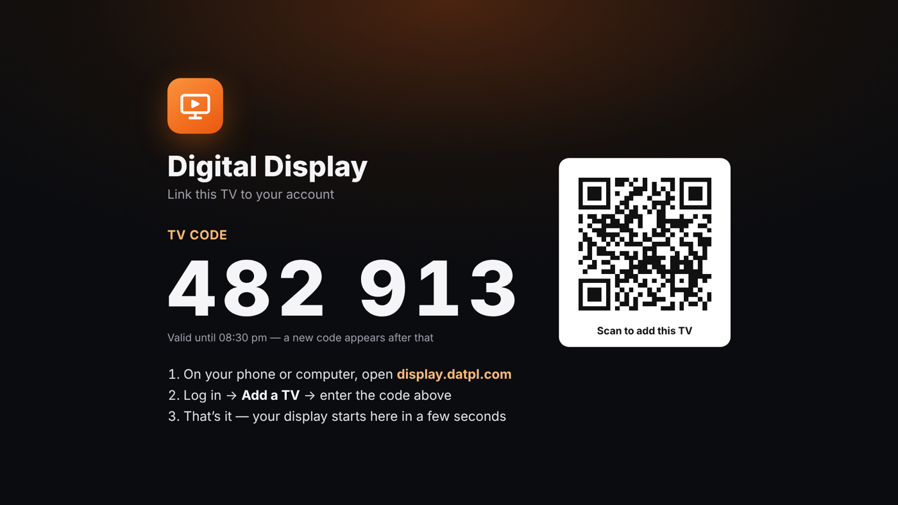
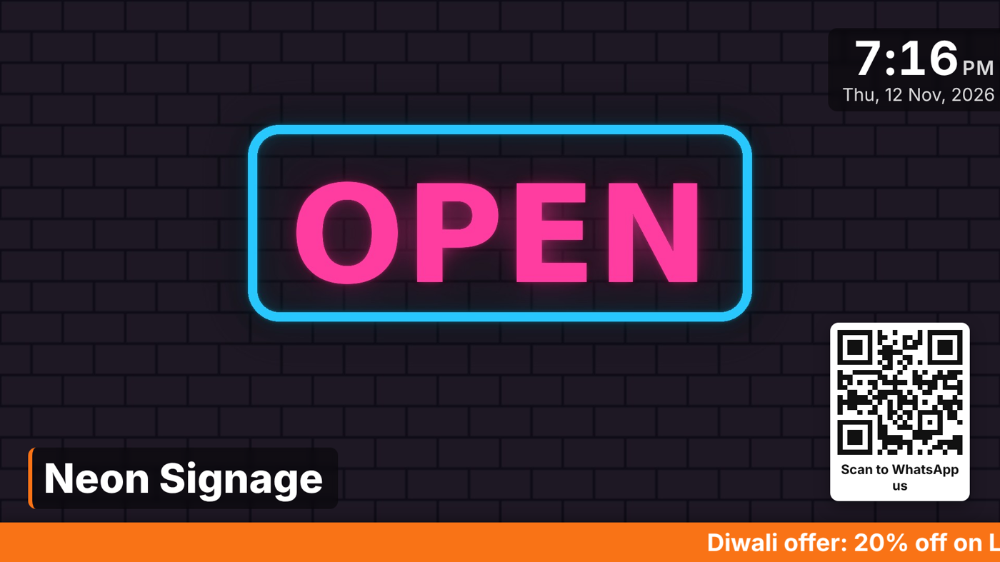
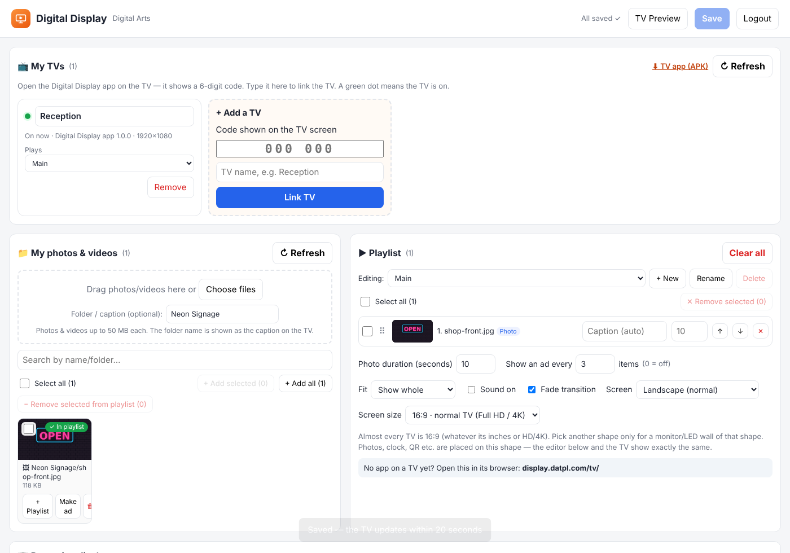
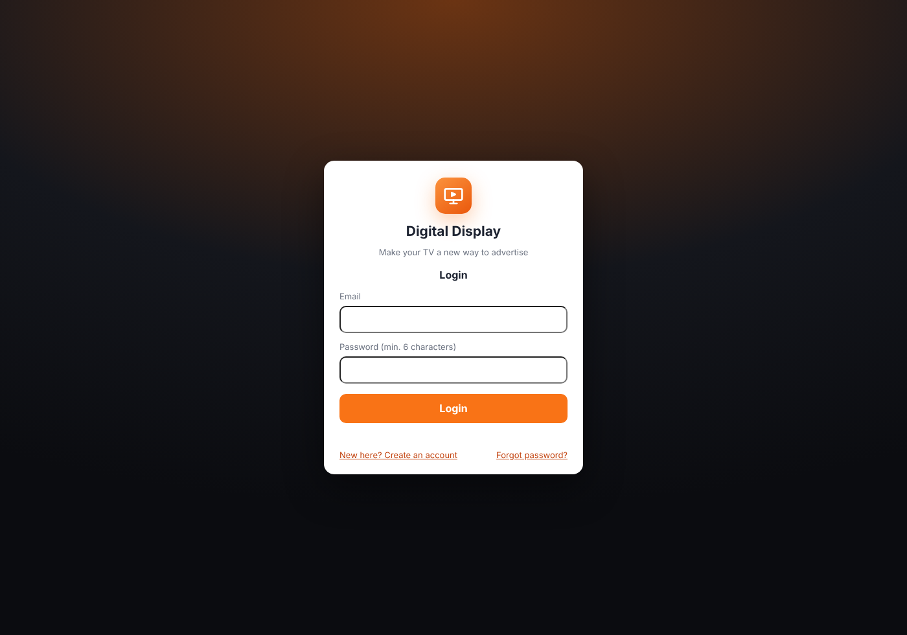

# Digital Display

**Make your TV a new way to advertise.** Any Android / Google TV in a shop, showroom, hotel or clinic becomes a digital signage screen. Upload photos, videos and offers on the website; the TV plays them by itself and keeps a saved copy for when the internet drops. No IP addresses, NAS or network setup.

- Dashboard: **https://display.datpl.com**
- TV app: **https://display.datpl.com/app** (short) or **/DigitalDisplay.apk** (Android TV 5.0+, Google TV, Mi TV)
- Without the app: open **display.datpl.com/tv** in the TV's browser

## Setup in 5 steps

1. **Install the app on the TV** — copy the APK to a pen drive, or open the link above in the *Downloader* app on the TV. Allow "install unknown apps" when the TV asks.
2. **Open the app.** The first time it asks for *Display over other apps* — allow it, so the app opens by itself whenever the TV is turned on.
3. **The TV shows a 6-digit code** (e.g. 482 913) and a QR code.
4. **On a phone or computer open display.datpl.com** (or scan the QR) → create an account / log in → **Add a TV** → type the code and a name.
5. **Upload photos/videos → add them to the playlist → Save.** The TV starts playing within seconds. Every later change is made from anywhere, without touching the TV.

 
 

## Features

- **Link a TV with a code** — the TV's IP address or network does not matter; the shop can be anywhere
- **Starts with the TV**, the screen never sleeps; BACK must be pressed twice to leave; hold OK for the menu
- **Updates itself** from display.datpl.com, and shows its version and whether it is the latest
- **Offline copy** — every file in the playlist is saved on the TV and keeps playing without internet
- **Many TVs and many playlists** per account (e.g. "Reception", "Branch 2", "Festival offers"); choose what each TV plays
- TV status: **green dot = on**, and when it was last seen
- Ads: every N items, at fixed times, with date / weekday / time windows
- Logo, clock, product captions (from the folder name), WhatsApp QR, scrolling ticker, guest welcome screen
- Pixel-level **layout editor**, portrait TVs, screen shapes (16:9, 4:3, 21:9 …)

## Updating the TV app

The TV app updates itself from the website:

- It checks **display.datpl.com/version.json** shortly after it starts and then every 6 hours. When a newer version is there it downloads it and shows *Update Digital Display?* for one minute; press **Install now** (Android asks once to allow the app to install apps, and then for one more *Install* press — ordinary apps can't update silently).
- On the remote, **hold OK for 2 seconds** (or press MENU) → menu with the app version and *latest version ✓* / *update available*, **Reload display**, **Check for updates**, **Exit app**.
- The TV's code screen shows the app version; a small *Update available* badge appears in the corner when the TV is behind. The dashboard shows each TV's app version and whether it is the latest.

**Releasing a new version (when you want):** in [`android/app/build.gradle`](android/app/build.gradle) raise `versionCode` by 1 and set `versionName` (e.g. 1.2.0), write what changed in [`android/release-notes.txt`](android/release-notes.txt), and push to `main`. The workflow builds the APK and publishes it with the new `version.json`; TVs pick it up within 6 hours, or at once with *Check for updates*. The player page and dashboard (the website) update by themselves on every push — no app update needed for those.

## How it is built

| Part | Folder | |
|---|---|---|
| Dashboard (website) | [`web/index.html`](web/index.html) | login, TVs, uploads, playlists, ads, layout |
| TV player page | [`web/tv/`](web/tv/) | code screen, player, offline copy ([`sw.js`](web/tv/sw.js)) |
| Android TV app | [`android/`](android/) | full-screen WebView that starts with the TV; tries display.datpl.com, then the GitHub Pages address |
| Server | Supabase project `da-connect` | tables `dn_*`, storage bucket `dn-media`, RPCs `dn_device_hello` / `dn_claim_screen` / `dn_bootstrap` |

- Every customer's data is separate (row level security). A TV reads only its own playlist, using a secret kept inside the app.
- `web/config.js` holds Supabase's *publishable* key, which is meant to be public, and the public address `display.datpl.com`.
- Files are stored in the bucket `dn-media` as `<account-id>/<random>.jpg`. The bucket is public so TVs can play without logging in; names cannot be guessed.
- Supabase free plan: max 50 MB per file.

## Publishing (automatic)

Any change under `digital-display/` pushed to `main` runs [`.github/workflows/digital-display.yml`](../.github/workflows/digital-display.yml):
1. builds the APK (also kept in the release **digital-display-latest**),
2. publishes the website with the APK to GitHub Pages → **display.datpl.com**.

### One-time setup

1. **GitHub › Settings › Pages** › Source: **GitHub Actions**. Custom domain: `display.datpl.com` › Save, then tick *Enforce HTTPS* once it is offered.
2. **DNS for datpl.com** (where the domain is managed): add a **CNAME** record `display` → `datplindia.github.io`.
3. **Supabase › Authentication › URL Configuration** › add `https://display.datpl.com` to *Redirect URLs* (sign-up and password-reset e-mails come back to the dashboard).
4. Re-run the workflow once (Actions › *Digital Display* › Run workflow).

**Signing key:** `android/keystore/digitaldisplay.jks` is in this (public) repository so every new APK installs over the old one. To use a private key instead, add the secrets `DN_KEYSTORE_B64` (base64 of the .jks), `DN_KEYSTORE_PASSWORD` and `DN_KEY_ALIAS`; TVs then need the app removed and installed once more.
