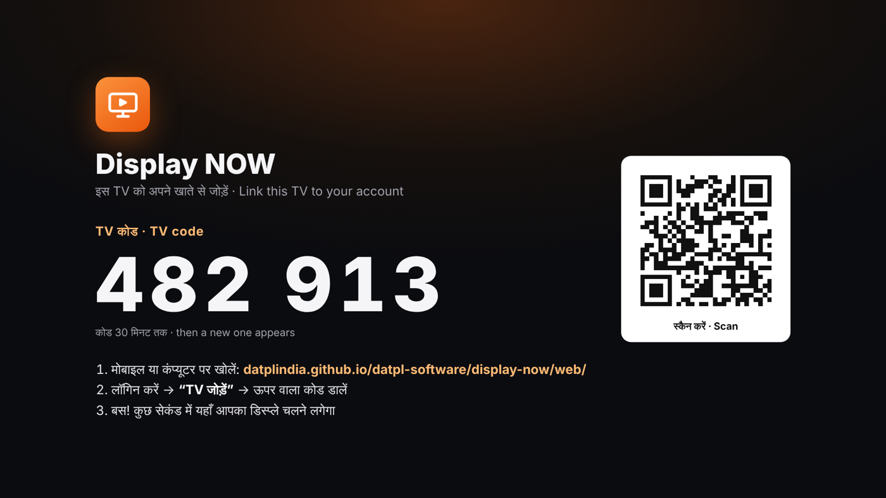
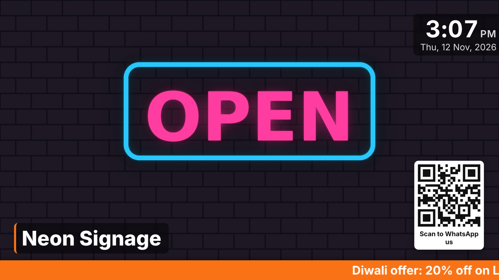
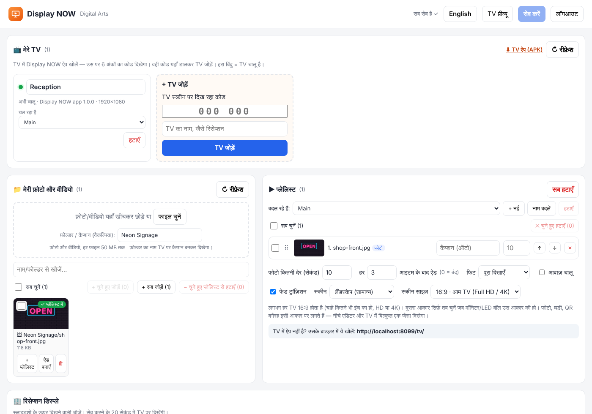
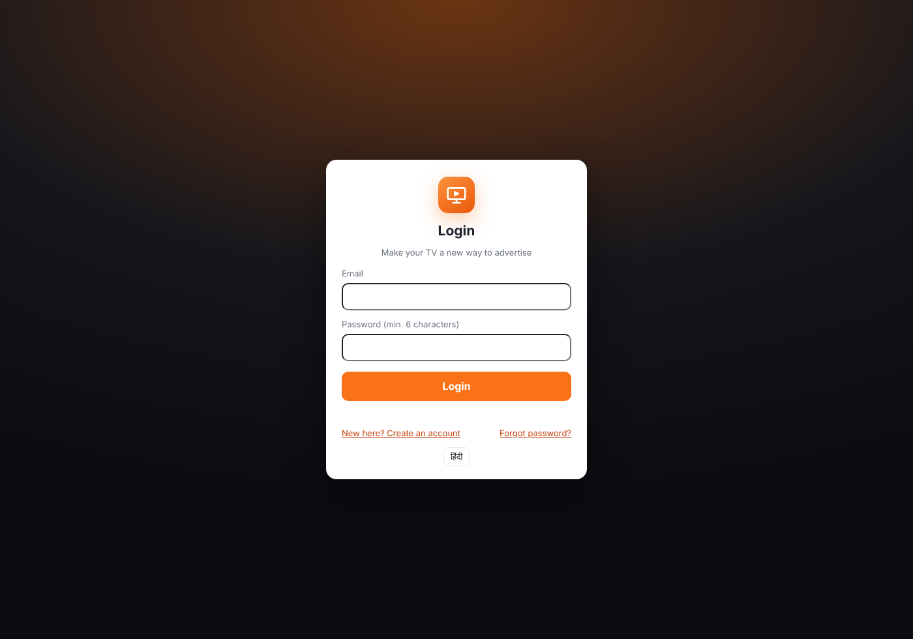

# Display NOW

**अपने TV को बनाइए विज्ञापन का नया ज़रिया।** दुकान, शोरूम, होटल या क्लिनिक का कोई भी Android / Google TV डिजिटल विज्ञापन स्क्रीन बन जाता है। फ़ोटो, वीडियो, ऑफ़र और ऐड वेबसाइट से डालें; TV पर अपने-आप चलते हैं। IP, NAS या नेटवर्क की कोई झंझट नहीं, और इंटरनेट जाने पर भी TV में रखी कॉपी चलती रहती है।

**Make your TV a new way to advertise.** Any Android / Google TV becomes a digital signage screen. Upload photos, videos and offers on the website; the TV plays them by itself and keeps a saved copy for when the internet drops.

- डैशबोर्ड / Dashboard: **https://datplindia.github.io/datpl-software/display-now/web/**
- TV ऐप / TV app: **[DisplayNOW.apk](https://github.com/datplindia/datpl-software/releases/download/display-now-latest/DisplayNOW.apk)** (Android TV 5.0+, Google TV, Mi TV)
- ऐप के बिना / Without the app: TV ब्राउज़र में `…/display-now/web/tv/` खोलें

## सेटअप: 5 कदम / Setup in 5 steps

1. **TV में ऐप डालें।** APK पेन ड्राइव में कॉपी करें, या TV पर *Downloader* ऐप से ऊपर वाला लिंक खोलें। इंस्टॉल करते समय TV "unknown apps" की अनुमति माँगे तो दे दें।
2. **ऐप खोलें।** पहली बार ऐप "Display over other apps" की अनुमति माँगेगा; दे दें, ताकि TV चालू होते ही ऐप अपने-आप खुले।
3. **TV पर 6 अंकों का कोड दिखेगा** (जैसे 482 913)। साथ में QR भी है।
4. **मोबाइल या कंप्यूटर पर डैशबोर्ड खोलें** (या QR स्कैन करें) → खाता बनाएँ / लॉगिन → **"TV जोड़ें"** में कोड और TV का नाम डालें।
5. **फ़ोटो/वीडियो अपलोड करें → प्लेलिस्ट में जोड़ें → सेव।** कुछ सेकंड में TV पर चलने लगेगा। आगे के बदलाव कहीं से भी, TV छुए बिना।

Install the APK on the TV, allow "Display over other apps", note the 6-digit code, then in the dashboard sign up, press **Add TV**, type the code, upload content and save.

 
 

## क्या-क्या है / Features

- **कोड से TV जोड़ना**: TV का IP या नेटवर्क मायने नहीं रखता, दुकान कहीं भी हो
- **TV चालू होते ही ऐप खुलता है**, स्क्रीन स्लीप में नहीं जाती; रिमोट का BACK दो बार दबाने पर ही बाहर निकलता है, MENU दबाने पर रीलोड
- **ऑफ़लाइन कॉपी**: प्लेलिस्ट की हर फ़ाइल TV में सेव रहती है; इंटरनेट न हो तब भी चलती रहती है
- एक खाते में **कई TV** और **कई प्लेलिस्ट** (जैसे "रिसेप्शन", "ब्रांच 2", "त्योहार ऑफ़र"); हर TV पर कौन-सी चले, ये चुनें
- हर TV की स्थिति: **हरा बिंदु = चालू**, आख़िरी बार कब दिखा
- ऐड: हर N आइटम के बाद, तय समय पर, तारीख़ / दिन / समय-सीमा के साथ
- लोगो, घड़ी, प्रोडक्ट कैप्शन (फ़ोल्डर के नाम से), WhatsApp QR, चलती पट्टी, मेहमान का स्वागत स्क्रीन
- पिक्सल-लेवल **लेआउट एडिटर**, पोर्ट्रेट TV, स्क्रीन साइज़ (16:9, 4:3, 21:9 …)
- हिंदी / English

## कैसे बना है / How it is built

| हिस्सा / Part | फ़ोल्डर / Folder | |
|---|---|---|
| डैशबोर्ड (वेबसाइट) | [`web/index.html`](web/index.html) | GitHub Pages पर; लॉगिन, TV, फ़ाइलें, प्लेलिस्ट |
| TV प्लेयर पेज | [`web/tv/`](web/tv/) | कोड स्क्रीन, प्लेयर, ऑफ़लाइन कॉपी ([`sw.js`](web/tv/sw.js)) |
| Android TV ऐप | [`android/`](android/) | फ़ुल-स्क्रीन WebView, बूट पर शुरू; GitHub Actions से APK बनता है |
| सर्वर | Supabase प्रोजेक्ट `da-connect` | टेबल `dn_*`, स्टोरेज बकेट `dn-media`, RPC `dn_device_hello` / `dn_claim_screen` / `dn_bootstrap` |

- हर ग्राहक का डेटा अलग: Row Level Security; TV बिना लॉगिन के सिर्फ़ अपने गुप्त कोड (secret) से अपनी प्लेलिस्ट पढ़ पाता है।
- `web/config.js` में Supabase का *publishable* key है; ये सार्वजनिक रखने के लिए ही होता है।
- फ़ाइलें बकेट `dn-media` में `<खाता-id>/<random>.jpg` नाम से; बकेट public है ताकि TV बिना लॉगिन के चला सके (नाम अंदाज़ा लगाने लायक नहीं)।
- फ़्री Supabase प्लान में एक फ़ाइल अधिकतम 50 MB।

## APK बनाना / Building the APK

`display-now/android/` में कुछ भी बदलें और `main` पर push करें; workflow [`display-now-apk.yml`](../.github/workflows/display-now-apk.yml) APK बनाकर रिलीज़ **display-now-latest** में डाल देता है। हाथ से चलाना हो तो Actions › *Display NOW TV app (APK)* › **Run workflow**।

**साइनिंग की चाबी / Signing key:** अभी `android/keystore/displaynow.jks` रिपॉज़िटरी में है, ताकि हर नया APK TV पर पुराने के ऊपर अपडेट हो सके। रिपॉज़िटरी public है, इसलिए बेहतर है कि अपनी निजी चाबी बनाकर GitHub › Settings › Secrets › Actions में `DN_KEYSTORE_B64` (jks का base64), `DN_KEYSTORE_PASSWORD` और `DN_KEY_ALIAS` डालें; तब workflow वही इस्तेमाल करेगा। (चाबी बदलने पर TV में ऐप एक बार हटाकर दोबारा इंस्टॉल करना होगा।)

## वेबसाइट चालू करना / Turning on the website (one time)

GitHub › **Settings › Pages** › Source: *Deploy from a branch* › Branch: `main`, फ़ोल्डर `/ (root)` › Save। कुछ मिनट बाद डैशबोर्ड ऊपर वाले पते पर खुलेगा।

Supabase › Authentication › URL Configuration › **Redirect URLs** में डैशबोर्ड का पता जोड़ें, ताकि साइन-अप और पासवर्ड-रीसेट ईमेल का लिंक डैशबोर्ड पर ही लौटे।
