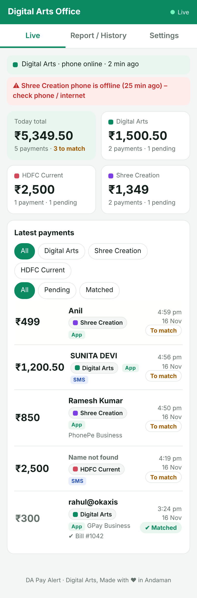
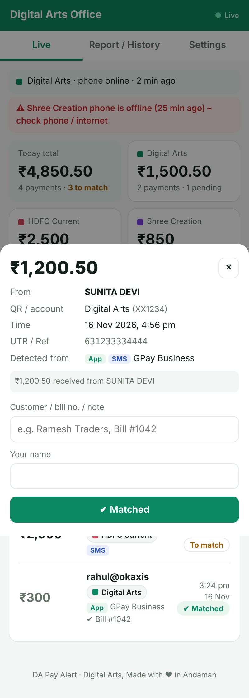
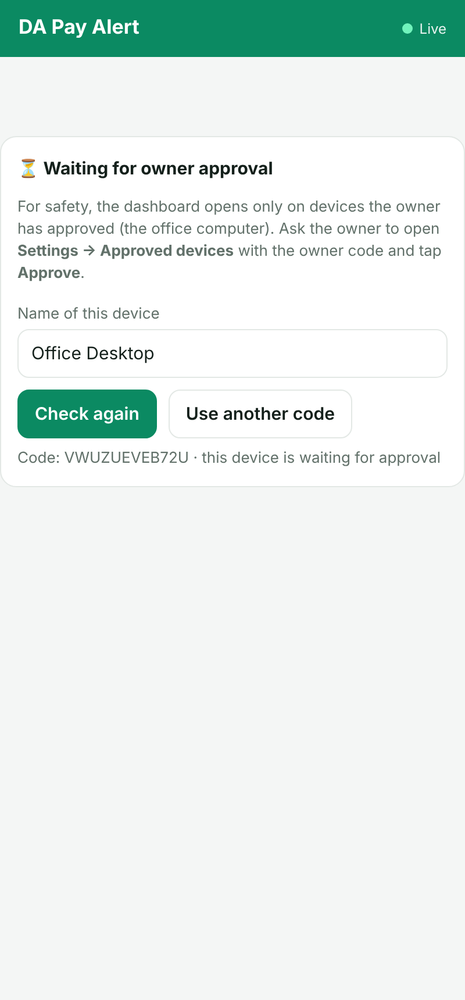

# DA Pay Alert

**QR और बैंक में आया हर पेमेंट ऑफ़िस के कंप्यूटर पर लाइव — स्टाफ को बार-बार फ़ोन करके पूछना नहीं पड़ेगा।**
Every payment on your QR codes and bank accounts, live on the office computer.

- डैशबोर्ड / Dashboard (office computer): **https://display.datpl.com/pay/**
- Android ऐप / app: **[DAPayAlert-1.4.1.apk](https://github.com/datplindia/datpl-software/raw/main/pay-alert/DAPayAlert-1.4.1.apk)** (Android 7+)

## कैसे काम करता है / How it works

- QR / बैंक-SMS वाले फ़ोन पर ऐप GPay Business, PhonePe Business के नोटिफ़िकेशन और बैंक के "credited" SMS पढ़कर पेमेंट सर्वर पर भेजता है (इंटरनेट न हो तो बाद में)।
- एक ही पेमेंट ऐप और SMS दोनों से आए तो एक ही गिना जाता है (UTR / रकम + समय से)।
- सिर्फ़ वही अकाउंट गिने जाते हैं जिन्हें Settings में नाम दिया हो (करंट / CC)। सेविंग, लोन वग़ैरह नहीं।
- अकाउंटेंट हर पेमेंट पर "Matched" लगाकर बिल / ग्राहक लिख सकता है। रिपोर्ट और Excel (CSV)।
- **Debits / EMI** टैब: लोन / EMI कटौती, सिर्फ़ मालिक के कोड से।

## सुरक्षा / Security

- तीन कोड: **Phone code** (सिर्फ़ पेमेंट भेजता है), **View code** (सिर्फ़ Approve किए डिवाइस पर), **Owner code** (सब कुछ)। कोड इस रिपॉज़िटरी में नहीं हैं।
- डैशबोर्ड सिर्फ़ उन्हीं डिवाइस पर खुलता है जिन्हें मालिक ने **Settings → Approved devices** में Approve किया है।
- सिर्फ़ बैंक के आधिकारिक SMS (जैसे JM-UNIONB-S) माने जाते हैं; किसी मोबाइल नंबर से आया नकली "credited" SMS नहीं।

## अपडेट / Updates

ऐप (v1.4.1 से) हर 3 घंटे में और खोलते समय [`version.json`](version.json) देखता है। उसमें `versionCode` बड़ा हो तो नया APK डाउनलोड करता है, SHA-256 मिलाता है और इंस्टॉल करता है।
The app (from v1.4.1) checks [`version.json`](version.json) every 3 hours and on open; a higher `versionCode` is downloaded, checked (SHA-256) and installed.

नया वर्ज़न डालने के लिए / To release: नया APK इस फ़ोल्डर में रखें और `version.json` में `version`, `versionCode`, `url`, `sha256` बदलें, फिर main में push करें।
Put the new APK in this folder, update `version`, `versionCode`, `url` and `sha256` in `version.json`, and push to main.

## स्क्रीनशॉट / Screenshots (demo data)

  
