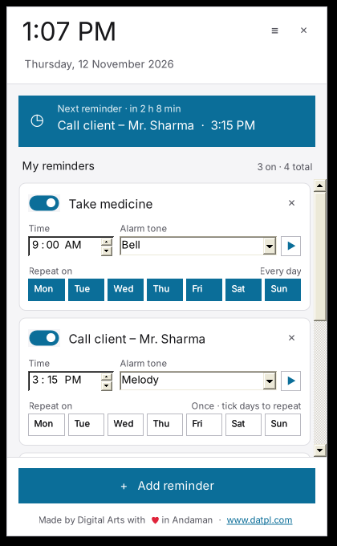
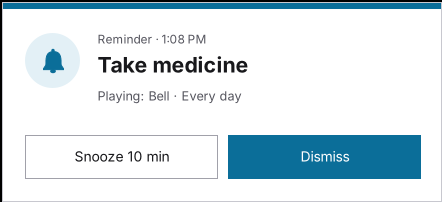

# Reminders

Free Windows app by Digital Arts. A bell icon sits next to the clock; click it to add reminders, tick the days they repeat and give each one its own alarm tone.

रिमाइंडर: Windows के लिए मुफ़्त ऐप। घड़ी के पास घंटी पर क्लिक करें, रिमाइंडर जोड़ें, दिन टिक करें और हर रिमाइंडर की अपनी टोन चुनें।

- Download: [Reminders.exe](https://apps.datpl.com/dl/datpl-software/raw/main/reminders/Reminders.exe) (v1.2, Windows 10 / 11, no installation)
- [Installation guide (PDF)](docs/Reminders-Installation-Guide.pdf) · [Features (PDF)](docs/Reminders-Features.pdf)

 

## Features
- As many reminders as you like: name, time, on/off, delete
- Repeat on: tick Mon–Sun (none ticked = one time)
- Alarm tone per reminder: Bell, Temple bell, Digital beep, Birds, Melody or your own MP3 / WAV / WMA, with ▶ preview
- Alarm popup with Snooze 10 min / Dismiss; tone stops by itself after 3 minutes
- Panel shows time, date and the next reminder
- Optional Start with Windows (Startup-folder shortcut) and Start menu entry
- Data stays on the computer: `%APPDATA%\DigitalArts\Reminders\`

## Changelog
- **1.2** (12 Nov 2026): Welcome screen, Startup shortcut instead of a Run key, Win 11 tray icon shown next to the clock, "Made by Digital Arts with ♥ in Andaman · www.datpl.com".
- **1.1**: Tick the days (Mon–Sun).
- **1.0**: First release.

Made by Digital Arts with ♥ in Andaman · [www.datpl.com](https://www.datpl.com)
