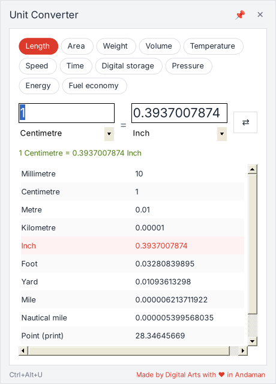

# Unit Converter – by Digital Arts

टास्कबार के कोने में रहने वाला मुफ़्त यूनिट कन्वर्टर। एक क्लिक या **Ctrl + Alt + U** से टास्कबार के ठीक ऊपर खुलता है।

A free Windows unit converter that lives in the taskbar corner and opens just above the taskbar in one click or with **Ctrl + Alt + U**.

## ⬇️ डाउनलोड / Download

**[UnitConverter.exe](https://github.com/datplindia/datpl-software/raw/main/unit-converter/UnitConverter.exe)**: Windows 10 / 11, लगभग 60 KB। कुछ भी इंस्टॉल नहीं करना पड़ता।

- [Installation guide (PDF)](docs/Unit-Converter-Installation-Guide.pdf)
- [All features (PDF)](docs/Unit-Converter-Features.pdf)

## फ़ीचर / Features

- टास्कबार के कोने (घड़ी के पास) में लाल ⇄ आइकन। क्लिक करते ही पैनल टास्कबार के ठीक ऊपर खुलता है।
- **Ctrl + Alt + U** किसी भी प्रोग्राम से खोलता है। Esc या बाहर क्लिक करने पर छिप जाता है।
- 11 कैटेगरी, 95+ यूनिट: लंबाई, क्षेत्रफल, वज़न, आयतन, तापमान, गति, समय, डिजिटल स्टोरेज, दबाव, ऊर्जा, माइलेज। तोला, क्विंटल और kWh (बिजली यूनिट) भी।
- एक साथ सभी यूनिट में वैल्यू। किसी पंक्ति पर डबल-क्लिक करने से वैल्यू कॉपी।
- दोनों तरफ़ से कन्वर्ट करें, ⇄ या Ctrl + S से यूनिट बदलें।
- Windows के साथ अपने-आप शुरू (आपकी मर्ज़ी से)। ऑफ़लाइन, कोई विज्ञापन नहीं।

## कैसे चलाएँ / How to use

1. `UnitConverter.exe` डाउनलोड करें और किसी पक्के फ़ोल्डर में रखें, जैसे `C:\Digital Arts\Unit Converter`।
2. डबल-क्लिक करें। "Windows protected your PC" आए तो **More info → Run anyway**।
3. Welcome विंडो में दोनों बॉक्स टिक रहने दें → **Open Unit Converter**।
4. आइकन न दिखे तो घड़ी के पास **^** खोलकर आइकन को टास्कबार पर खींच दें।

## बदलाव / Changelog

- **1.0.1** (12 Nov 2026): पहला रिलीज़ / First release. "Made by Digital Arts with ♥ in Andaman".

---
Made by Digital Arts with ♥ in Andaman · [www.datpl.com](https://www.datpl.com) · [apps.datpl.com](https://apps.datpl.com) · WhatsApp +91 99332 11177
